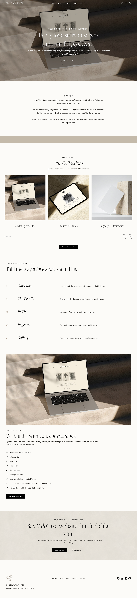

# Glam Vows Studio

> A faithful build of the **GlamVowsStudio** homepage design — an elegant wedding‑website & digital‑invitation studio — as a **Django REST API + React (Vite)** front end backed by **SQLite**.



The entire page (hero, "Our Why", collections, the five chapters, the customization
checklist, final call‑to‑action and footer) is stored as structured content in SQLite
and served to React through a small JSON API — so every word and image can be edited in
the Django admin without touching code.

## Tech stack

| Layer     | Tech                                                        |
|-----------|-------------------------------------------------------------|
| Backend   | Python · Django 5 · Django REST Framework · Pillow          |
| Database  | SQLite                                                       |
| Frontend  | React 19 · Vite · React Router · Axios                       |
| Fonts     | Editor's Note (display) · Neue Haas Grotesk Display Pro (body) |

## Features

- **Content‑driven** — all copy, nav, collections, chapters, checklist and footer live in the DB and are editable via the Django admin.
- **Clean API boundary** — React fetches one `/api/homepage/` endpoint; Vite proxies `/api` and `/media` to Django in dev.
- **Component‑per‑section** front end — Hero, Why, Collections, Chapters, Showcase, Customize, FinalCta, Navbar, Footer.
- **Faithful design system** — cream `#FCFBF8` palette, serif/italic display headings, letter‑spaced eyebrows, matching buttons and dividers.
- **Seeded + ready to run** — ships with a pre‑seeded database and placeholder imagery so it renders on first launch.

## Project structure

```
glam-vows-studio/
├── backend/          Django project (API + SQLite + media)
│   ├── config/       settings, urls, wsgi/asgi
│   ├── api/          models, serializers, views, admin, seed commands
│   ├── media/figma/  homepage imagery
│   └── db.sqlite3    pre-seeded database
├── frontend/         React app (Vite)
│   └── src/
│       ├── components/  Navbar, Footer, RichText, icons
│       ├── sections/    Hero, Why, Collections, Chapters, Showcase, Customize, FinalCta
│       └── styles/      global.css (palette/type), sections.css
└── docs/             screenshots
```

## Run it

Open two terminals.

### 1. Backend (Django API, port 8000)

```bash
cd backend
python -m venv .venv
# Windows:
.venv\Scripts\activate
# macOS/Linux:
# source .venv/bin/activate

pip install -r requirements.txt

# The included db.sqlite3 is already seeded. To rebuild from scratch instead:
#   python manage.py migrate
#   python manage.py generate_assets   # creates media/figma placeholder images
#   python manage.py seed_homepage     # loads all homepage copy

python manage.py runserver
```

API: http://127.0.0.1:8000/api/homepage/ · Admin: http://127.0.0.1:8000/admin/
(create a login with `python manage.py createsuperuser` to edit content).

### 2. Frontend (React, port 5173)

```bash
cd frontend
npm install
npm run dev
```

Open **http://localhost:5173** — run both servers together.

## Fonts

The Figma design uses two commercial fonts:

- **Editor's Note** (Extralight, Light + italics) for headings, logo and card titles
- **Neue Haas Grotesk Display Pro 55 Roman** for body, nav and buttons

They're wired up in `frontend/src/styles/fonts.css`. Put the licensed files in
`frontend/public/fonts/` (file names listed in the README there) and they load
automatically. Until then, size-matched open fallbacks are used: Noto Serif Display
(condensed) and Inter Tight.

Italic emphasis in headings is stored in the DB with `*asterisks*` and rendered as
`<em>` by `components/RichText.jsx`.

## Images

`backend/media/figma/` holds the **real photos exported from the Figma file**:

| file               | where it appears                    |
|--------------------|-------------------------------------|
| `hero.jpg`         | hero background                     |
| `collection-1.jpg` | "Wedding Websites" card             |
| `collection-2.jpg` | "Invitation Suites" card            |
| `collection-3.jpg` | "Signage & Stationery" card         |
| `showcase.jpg`     | large mockup section                |
| `cta-texture.jpg`  | final call‑to‑action paper texture  |

The footer "GV" monogram lives in `frontend/src/assets/monogram.png`.
`python manage.py generate_assets` only creates placeholder stand-ins and will
**overwrite** these photos, so don't run it unless you need placeholders.
